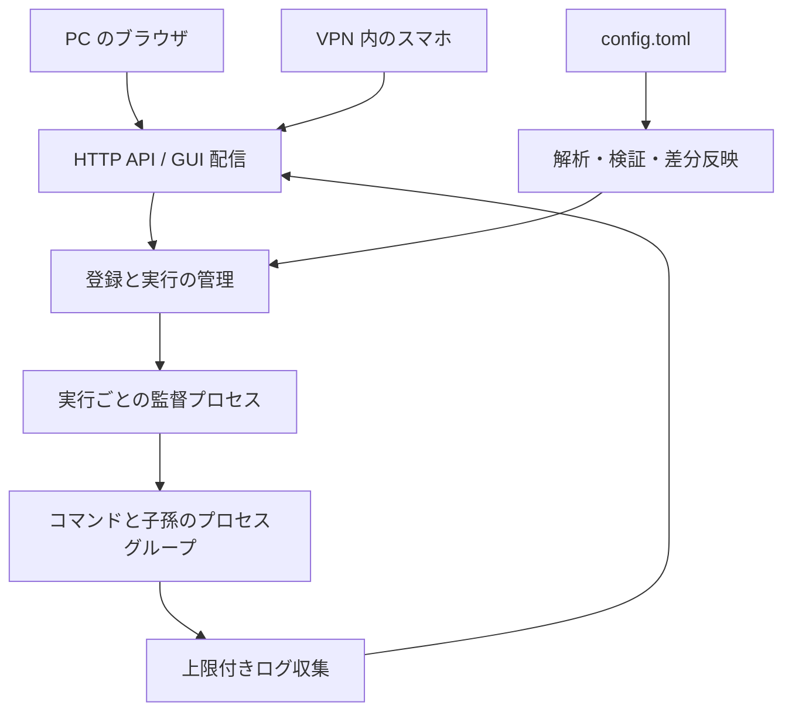

# Procshelf の設計方針

Procshelf は Linux 上でコマンドとその子プロセスを管理し、PC・スマホの Web GUI から起動、停止、強制終了、再起動、ログ閲覧を行う個人用ツールである。管理サービスはブラウザから独立して動作する。対象はフォアグラウンドで動く非対話型コマンドとする。

## 設定ファイルで登録を管理する

プロセスの登録内容は `config.toml` で管理し、GUI は実行を操作する。各登録のキーを固定 ID とし、起動ごとの実行 ID、設定の世代を分ける。実行には起動時点の設定を保持する。

- `autostart = true` は管理サービス起動時と新規登録時に自動起動する。
- `autostart = false` または省略時は手動で起動する。
- 手動停止、自然終了、異常終了の後に設定を再読込しても自動再起動しない。
- 既存登録の `autostart` 変更は次回の管理サービス起動から適用する。
- 実行設定の変更は次回起動で適用し、稼働中は適用待ちを表示する。
- 削除された稼働中の登録はログ・停止操作を残し、停止後に一覧から除外する。
- 設定全体を解析してから一括適用する。不正な設定・一時的な読込失敗では直前の有効な設定と実行を維持する。初回の不正設定は起動エラーとする。

監視は親ディレクトリへの通知と定期的な内容確認を組み合わせ、置き換え保存と通知漏れに対応する。通常の更新は 1 秒以内の表示反映を目標とする。Web の待ち受け変更はサービス再起動で適用する。

## 接続と信頼境界

デフォルトは `127.0.0.1:8787`。スマホ利用時は VPN インターフェースの IP を明示する。指定先で bind できない場合に `0.0.0.0` へフォールバックしない。公開インターネットは対象外であり、接続を許可された VPN 利用者はコマンドを操作できる信頼主体とする。専用のユーザー管理は初期版に含めない。

Host・Origin の検査、変更 API の CSRF 対策、同一オリジンからの GUI 配信を行う。環境変数の値を API へ返さず、ログは HTML として解釈しない。

## 構成と責務

Rust の管理サービスと TypeScript のレスポンシブ GUI を使用する。登録・設定・ログを機能単位に構成し、状態遷移と起動方針に対して HTTP、ファイル監視、OS 操作が依存する。入力は境界で検証済み型に変換し、実行ハンドルの所有と状態ごとに可能な操作を型で表現する。自然終了や並行した操作は実行時に直列化して整合させる。

状態は停止中、起動中、稼働中、停止処理中、終了、起動失敗を区別する。再起動は配下の停止・回収完了後に行う。古い実行 ID を対象とする要求は新しい実行を変更できない。管理サービス起動ごとのセッショントークンにより、サービス再起動前の操作要求も拒否する。GUI への接続や配信が遅れても、ログの読み取りとプロセス管理を妨げない。状態は SSE で完全なスナップショットを配信し、再接続時は最新状態に置き換える。ログは選択した登録を定期取得し、メモリ内で登録ごと 512 KiB / 2000 チャンクまで保持する。省略を明示し、永続的なログ保存は初期版に含めない。

## GUI の操作と情報配置

日常の操作は「一覧で状態を確認する」「対象を選んで起動・停止する」「結果をログで確認する」の順に進む。名前と状態を一覧の同じ行に置き、選択した対象の名前に続けて操作ボタンとログを配置する。コマンド、作業ディレクトリ、PID などは起動内容や障害を調べるときに必要になるため、開閉できる実行情報にまとめる。設定変更の適用待ち、削除、終了理由は操作判断に関わるため常時表示する。

ヘッダーはアプリ名と接続状態で識別に必要な情報を伝える。見出しに説明的な副題を添えるのではなく、操作に必要な場所へ情報を置く。余白は情報の区切り、可読性、操作対象の大きさを確保するために設ける。スマホでは一覧の高さを制限して操作とログへ到達しやすくし、操作ボタンは文字とアイコンの読みやすさを保つ 32px の高さに揃え、一覧の行には 44px 以上のタップ領域を確保する。

## 子孫の所有と障害時の扱い

開発環境では cgroup ファイルシステムが公開されていないため、初期版はプロセスグループを管理単位にする。`setsid` 等でグループから離脱するデーモンは対象外とし、コマンドはフォアグラウンド実行を設定する。cgroup による隔離は権限委譲を含めて別途検証する。

実行ごとの監督プロセスがグループを所有し、管理サービスとの制御パイプが閉じた場合にも配下を停止・回収する。設定ファイルの排他ロックを監督プロセスも保持し、管理サービスが異常終了しても回収完了まで同じ設定での重複起動を防ぐ。PID だけを保存して後から殺す方式を避ける。監督プロセス自体の強制終了やホスト障害までの回復保証はしない。停止が確認できない場合に停止済みと表示して重複実行を許さない。

参考: [Linux cgroup v2](https://docs.kernel.org/admin-guide/cgroup-v2.html)、[Tokio process](https://docs.rs/tokio/latest/tokio/process/)、[notify](https://docs.rs/notify/latest/notify/)。

## スタックと依存の選定

Rust 側は Tokio、Axum、Serde、TOML 解析、ファイル監視、Linux プロセス操作のライブラリを用途に応じて使用する。GUI は TypeScript、Preact、Zod、Vite を使用する。Preact が画面更新と状態管理を、Zod が API 応答の解析を担う。ビルド済みの資材を Rust バイナリに埋め込み、同一オリジンで配信する。選定結果と依存の確認方法は README に記録する。

直接・推移的・ビルド・テスト用の依存を評価するが、依存ゼロや数値の最小化を目的にしない。独自の HTTP パーサーや複雑な UI 更新処理を作るより、保守されたライブラリを利用する。重複する機能と未使用の機能は避ける。ロックファイルを追跡し、更新時に脆弱性と依存差分を確認する。

開発環境は Guix の `manifest.scm` に集約する。Rust、Cargo、Node.js、コンパイラ、証明書を Guix shell 内で利用する。アプリケーション依存は Cargo と npm のロックファイルで固定する。

## 実装・検証順序

1. 設定の解析と既定値を仕様テストで固定する。
2. 子孫を生成する実プロセスで起動・停止・強制終了・管理サービス切断を検証する。
3. 自動起動、手動停止の維持、設定の追加・変更・削除・復元を実装する。
4. API、状態・ログ配信、PC・スマホ共通 GUI を実装する。
5. 複数端末の競合、再接続、大量ログ、設定の置き換え保存を検証する。

TDD の赤・緑・リファクタリングを繰り返す。状態の仕様は単体テスト、OS と設定監視の契約は統合テスト、画面操作はブラウザで検証する。各変更に必要な formatter、linter、型検査を実行する。

初期版の完成条件は、設定保存でスマホの一覧が更新され、自動・手動起動を選べ、ブラウザを閉じても動作が続き、PC からログを見て停止できること。不正な設定を保存しても実行を維持し、修正後に追随を再開することも確認する。
