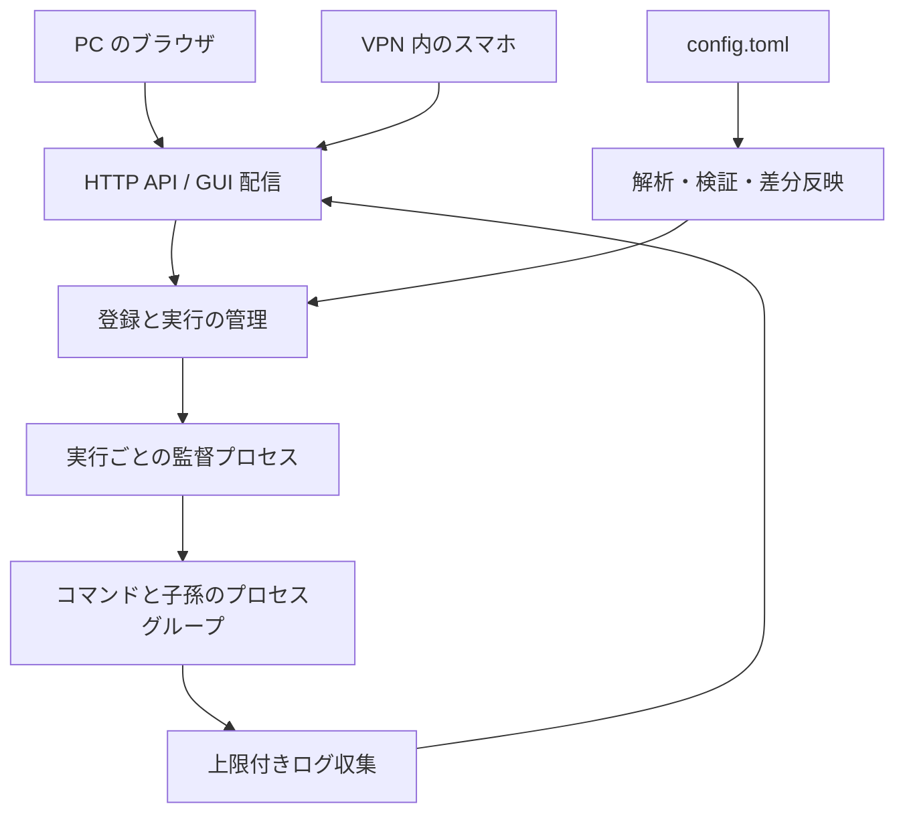

# Procshelf の設計方針

Procshelf は Linux 上でコマンドとその子プロセスを管理し、PC・スマホの Web GUI から起動、停止、強制終了、再起動、ログ閲覧を行う個人用ツールである。管理サービスはブラウザから独立して動作する。対象はフォアグラウンドで動く非対話型コマンドとする。

## 設定ファイルで登録を管理する

プロセスの登録内容は `config.toml` で管理し、GUI は実行を操作する。各登録のキーを固定 ID とし、起動ごとの実行 ID、設定の世代を分ける。実行には起動時点の設定を保持する。

- `autostart = true` は管理サービス起動時と新規登録時に自動起動する。
- `autostart = false` または省略時は手動で起動する。
- 手動停止、自然終了、異常終了の後に設定を再読込しても自動再起動しない。
- 既存登録の `autostart` 変更は次回の管理サービス起動から適用する。
- 実行設定の変更は次回起動で適用し、稼働中は適用待ちを表示する。
- 削除された稼働中の登録はログ・停止操作を残し、停止後に一覧から除外する。
- 設定全体を解析してから一括適用する。不正な設定・一時的な読込失敗では直前の有効な設定と実行を維持する。初回の不正設定は起動エラーとする。

監視は親ディレクトリへの通知と定期的な内容確認を組み合わせ、置き換え保存と通知漏れに対応する。通常の更新は 1 秒以内の表示反映を目標とする。Web の待ち受け変更はサービス再起動で適用する。

## 接続と信頼境界

デフォルトは `127.0.0.1:8787`。スマホ利用時は VPN インターフェースの IP を明示する。指定先で bind できない場合に `0.0.0.0` へフォールバックしない。公開インターネットは対象外とする。localhost・VPN のいずれでもアクセスキーで認証し、認証済みの利用者が全登録を閲覧・操作できる。ユーザーごとの権限分離は含めない。

Host・Origin の検査、変更 API の CSRF 対策、同一オリジンからの GUI 配信を行う。ログイン要求には専用ヘッダーを必須とし、クロスオリジンのフォーム送信では成立しないようにする。環境変数の値を API へ返さず、ログは HTML として解釈しない。

### アクセスキーとセッション

アクセスキーは OS の乱数源から生成した 256 ビットの値とし、設定と別の所有者限定ファイルへ保存する。キーの読み取り時に形式・所有者・権限を検証し、検証済みの `AccessKey` 型として保持する。セッションを作る際の比較には subtle を使い、独自の比較アルゴリズムを実装しない。

認証後は別のランダムなセッション識別子を HttpOnly・SameSite=Strict Cookie で渡し、有効期限と失効状態をサーバーのメモリで管理する。API の入口で認証し、検証済みの `AuthenticatedSession` をハンドラーへ渡す。ログアウト・12 時間の期限切れ・サービス再起動で失効する。イベント配信は開始時だけでなく配信中も有効性を確認し、失効後にプロセス情報を送らない。

[OWASP のセッション管理指針](https://cheatsheetseries.owasp.org/cheatsheets/Session_Management_Cheat_Sheet)を参考に、十分な乱数強度、Cookie の JavaScript からの隔離、サーバー側の期限判定を採用する。通信は暗号化された VPN 内または localhost の HTTP で、Secure Cookie を使用できないため、転送時の秘匿性は VPN に依存する。HTTPS での直接公開やプロキシ認証ヘッダーの信頼は対象外とする。

## 構成と責務

Rust の管理サービスと TypeScript のレスポンシブ GUI を使用する。登録・設定・ログを機能単位に構成し、状態遷移と起動方針に対して HTTP、ファイル監視、OS 操作が依存する。入力は境界で検証済み型に変換し、実行ハンドルの所有と状態ごとに可能な操作を型で表現する。自然終了や並行した操作は実行時に直列化して整合させる。

状態は停止中、起動中、稼働中、停止処理中、終了、起動失敗を区別する。再起動は配下の停止・回収完了後に行う。古い実行 ID を対象とする要求は新しい実行を変更できない。管理サービス起動ごとのセッショントークンにより、サービス再起動前の操作要求も拒否する。GUI への接続や配信が遅れても、ログの読み取りとプロセス管理を妨げない。状態は SSE で完全なスナップショットを配信し、再接続時は最新状態に置き換える。ログは選択した登録を定期取得し、メモリ内で登録ごと 512 KiB / 2000 チャンクまで保持する。省略を明示し、永続的なログ保存は初期版に含めない。

## GUI の操作と情報配置

各プロセスの用途は `config.toml` の `description` にプレーンテキストで記述する。省略時は空文字となる。詳細では対象名・状態の直下、実行操作より前に常時表示し、改行を保つ。説明だけの更新は実行状態に影響せず即時反映する。

日常の操作は「一覧で対象を探す」「起動・停止する」「結果をログで確認する」の順に進む。名前を主情報、状態を補助情報として扱い、列の比較を前提にした表にはしない。停止中は起動を青、稼働中は停止を赤の塗りつぶしで表示し、開始と停止の意味を色でも区別する。再起動は枠線の補助操作、強制終了は区切り線と赤い文字で通常操作から分ける。停止・再起動・強制終了は稼働中の処理を中断するため、対象名と操作内容を示す画面内の確認モーダルを挟む。初期フォーカスはキャンセルに置き、Esc でも閉じられる。キャンセル時は実行要求を送らない。

PC は複数の対象を順に確認するため、一覧と操作・ログを併置する。一覧は名前中心のコンパクトなナビゲーションとし、状態と対処が必要な通知を添える。一つのログに集中するときは「一覧を隠す」で横幅を使い、「一覧を表示」で同じ検索条件・一覧位置に戻れる。

スマホは一覧で対象を選んでから操作・ログへ進む。一覧を常設してログの横幅を狭めず、一覧へ戻る際には検索条件と表示位置を保持する。PC・スマホとも、実行情報は操作・ログと同じ画面で開閉する。コマンド、作業ディレクトリ、PID、自動起動などをログと見比べる際、別画面との往復を必要としない。

ログはページを縦にスクロールして読む。PC では時刻などの補助情報と本文を横に、スマホでは縦に並べる。自動追尾は初期状態で無効とし、読んでいる箇所を勝手に移動しない。接続断・設定エラー・終了理由は操作判断に必要なので、開閉する情報の中へ隠さない。

一覧と対象の画面はハッシュ URL で表し、ブラウザの戻る・進むと直接アクセスに対応する。選択した登録が削除されて存在しない場合は一覧へ戻る。接続断や設定読込エラーは各画面で表示し、設定変更の適用待ち、削除、終了理由も実行情報の中に隠さない。

ヘッダーはアプリ名と接続状態で識別に必要な情報を伝える。余白は情報の区切り、可読性、操作対象の大きさを確保するために設ける。主操作は 40px、補助操作は 32px の高さで重要度を分け、スマホの一覧には 44px 以上のタップ領域を確保する。

対象名は PC で 36px、スマホで 30px の太字とし、選択中の対象を画面の基点にする。一覧は落ち着いた背景の選択領域、詳細は白地の操作領域、ログは暗い背景の閲覧領域としてまとまりを示す。主操作は大きな塗りつぶし、再起動は枠線、強制終了は区切り線の先の赤い文字で重みを分ける。実行情報を小さくまとめ、その後の間隔で操作からログ閲覧への切り替わりを示す。

### ナビゲーションの配置判断

一覧はプロセスという作業対象を選ぶ領域であり、アプリ全体の機能を切り替えるメニューとは役割が異なる。[Material の一覧・詳細レイアウト](https://developer.android.com/develop/ui/views/layout/canonical-layouts)を参考に、広い画面では対象の切り替えと結果確認を並行できる配置、狭い画面では一覧から詳細へ進む配置とする。これは画面構成の根拠であり、特定の装飾や寸法をそのまま適用するものではない。

配置と表現を検討する際は、次の三つの操作を区別する。

- 対象の選択：一覧で名前と状態を確認し、選択した対象の操作・ログへ進む。
- 画面の移動・表示調整：一覧へ戻る、一覧を畳んでログの横幅を確保する。実行状態には影響しない。
- 実行の変更：選択した対象を起動・停止する。対象名と状態の近くで操作し、直後の結果をログで確認する。

[NN/g の近接の原則](https://www.nngroup.com/articles/gestalt-proximity/)に基づき、一覧の開閉は一覧の上端に、起動・停止は対象名の近くに所属させる。開閉でアプリ名や対象名の左にボタンを挿入すると、識別情報の位置が変わり、操作の所属も曖昧になる。タイトルの左端は各領域の基準として保つ。

スマホの戻り先はプロセス一覧である。詳細の見出しより前に、左矢印と行き先を明記したリンクとして配置する。枠付きの実行ボタンと見分けられ、対象名の左端も保てる。[GOV.UK の Back link](https://design-system.service.gov.uk/components/back-link/)が示す、本文より前の配置、明確な戻り先、元の表示状態への復帰を参考にする。履歴のない直接アクセスでも行き先を示せるよう、「プロセス一覧へ」の表記が適している。

PC の開閉操作は一覧見出しの右端に置く。畳んだ状態では詳細の上の左端に「一覧を表示」を置き、ログに全幅を使う。再表示操作には同じアイコンと横並びの文字を使い、キーボードのフォーカスを開閉後のボタンへ引き継ぐ。開閉は補助操作なので、起動・停止より強い色や面積を与えない。この具体的な配置は本アプリの用途からの設計判断であり、参照資料によって唯一の正解と保証されるものではない。

配置案は「停止中の対象を探して起動し、ログを確認する」「別の対象へ切り替える」「ログを広げてから一覧に戻る」の三つの経路で検証する。スマホでは検索条件とスクロール位置の復帰、長いプロセス名、指での押しやすさも確認する。キーボード操作では、開閉によって操作中の要素が消えても次の操作位置を見失わないことを確認する。

## 子孫の所有と障害時の扱い

開発環境では cgroup ファイルシステムが公開されていないため、初期版はプロセスグループを管理単位にする。`setsid` 等でグループから離脱するデーモンは対象外とし、コマンドはフォアグラウンド実行を設定する。cgroup による隔離は権限委譲を含めて別途検証する。

実行ごとの監督プロセスがグループを所有し、管理サービスとの制御パイプが閉じた場合にも配下を停止・回収する。設定ファイルの排他ロックを監督プロセスも保持し、管理サービスが異常終了しても回収完了まで同じ設定での重複起動を防ぐ。PID だけを保存して後から殺す方式を避ける。監督プロセス自体の強制終了やホスト障害までの回復保証はしない。停止が確認できない場合に停止済みと表示して重複実行を許さない。

参考: [Linux cgroup v2](https://docs.kernel.org/admin-guide/cgroup-v2.html)、[Tokio process](https://docs.rs/tokio/latest/tokio/process/)、[notify](https://docs.rs/notify/latest/notify/)。

## スタックと依存の選定

Rust 側は Tokio、Axum、Serde、TOML 解析、ファイル監視、Linux プロセス操作のライブラリを用途に応じて使用する。GUI は TypeScript、Preact、Zod、Vite を使用する。Preact が画面更新と状態管理を、Zod が API 応答の解析を担う。ビルド済みの資材を Rust バイナリに埋め込み、同一オリジンで配信する。選定結果と依存の確認方法は README に記録する。

直接・推移的・ビルド・テスト用の依存を評価するが、依存ゼロや数値の最小化を目的にしない。独自の HTTP パーサーや複雑な UI 更新処理を作るより、保守されたライブラリを利用する。重複する機能と未使用の機能は避ける。ロックファイルを追跡し、更新時に脆弱性と依存差分を確認する。

開発環境は Guix の `manifest.scm` に集約する。Rust、Cargo、Node.js、コンパイラ、証明書を Guix shell 内で利用する。アプリケーション依存は Cargo と npm のロックファイルで固定する。

## 実装・検証順序

1. 設定の解析と既定値を仕様テストで固定する。
2. 子孫を生成する実プロセスで起動・停止・強制終了・管理サービス切断を検証する。
3. 自動起動、手動停止の維持、設定の追加・変更・削除・復元を実装する。
4. API、状態・ログ配信、PC・スマホ共通 GUI を実装する。
5. 複数端末の競合、再接続、大量ログ、設定の置き換え保存を検証する。

TDD の赤・緑・リファクタリングを繰り返す。状態の仕様は単体テスト、OS と設定監視の契約は統合テスト、画面操作はブラウザで検証する。各変更に必要な formatter、linter、型検査を実行する。

初期版の完成条件は、設定保存でスマホの一覧が更新され、自動・手動起動を選べ、ブラウザを閉じても動作が続き、PC からログを見て停止できること。不正な設定を保存しても実行を維持し、修正後に追随を再開することも確認する。
